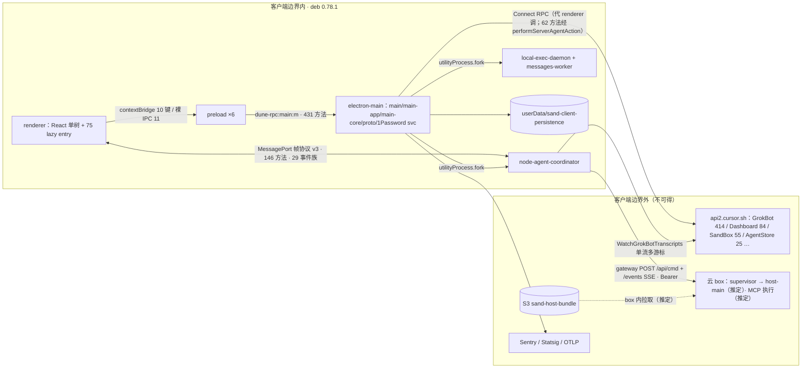

# ARCH-0.78 · Grok Bot 0.78.1 架构总参照（P1 出口）
2026-11-01 · director · 输入：work/p1-re/RE-*.md 九份 + BRIEF §6。引用格式 `RE-<名>.md §n[:行]`；「推定」= 0.78.1 客户端不可得、取自 0.18；「ARCH 复核」= 本文合并时补做的静态 grep（树 `/dev/shm/grok-re/0.78.1/app/dist`）。
**优先级**：与 RE 冲突处以本文为准；owners.tsv 归属列是机械规则产物，与本文冲突时以本文为准（不改 w05.py，以免牵动 D7 复跑 diff）。

## 0. 四项裁决
1. **host 交付机制 → 以 RE-host-ext 为准**。host 两版都在云 box 内运行；0.78.1 只是删掉了 asar 里那份 baked 的 `dist/host`（RE-host-ext.md §结论:7）。`main-app.cjs` 里的 `incoming-host-bundle.tgz`/S3/supervisor 常量组只有声明、没有使用（RE-host-ext.md §结论:8；ARCH 复核 `grep -oE 'YHt|TCe|WHt'` 计数 2/3/2，全部落在声明区）。RE-ipc-rpc.md §2.2:73 独立得到同一结论（main/coordinator/daemon 对 `/tmp/sand-supervisor`、`/opt/sand` 只有常量段命中）。下载、换装和启动都在 box 内，客户端不可得，标「推定」。以下表述**作废**：RE-w05.md §结论:10、§6:132「host 交付走 main-app 下发」，RE-cloud-deps.md §主表 #6「main 下载」，BRIEF §4-4、§8 的同义句。另外，RE-cloud-deps.md §局限:47 说「bucket 静态不可得」，已被 RE-ipc-rpc.md §2.2:69 推翻：`public-asphr-vm-daemon-bucket` 以死常量形式存在。
2. **归属改判 → 两份都采纳，并按下面的规则合并**。(a) RE-ui-shell.md §W0.5 归属补全:205-207 的 3 条全部采纳：chunk-view 74、chunk-onboarding-flow、chunk-settings 36 改归 ui-shell。证据精确到 §1.3 注册表逐条、§1.5、§2.4，优先于 RE-ipc-rpc 的分组口径。(b) RE-ipc-rpc.md §6:190-192 的 212 行：具名 8 行照单采纳（preload-webview 改为非 MVP:computer-use，sandPopout 改归 ui-shell）；deps 26 行采纳；chunks 178 行中，语言文法、shiki 和会话/消息 UI 统一定为 **ui-shell**。它原文写的「features/ui-shell」有歧义，ARCH 定为 ui-shell。名称属于计费、结账、虚拟卡、computer-use、电话、教学录制的 chunk 定为非 MVP 行；10 个入口 bundle 留在 ipc-rpc。(c) 两份的改判方向一致，没有实质冲突，owners.tsv 不回写，只靠上面的「优先级」行声明以本文为准。
3. **旅程①「每 bot 选 agent 配置」→ 定论：0.78.1 不存在，标「新（复刻自建）」**。依据：RE-ipc-rpc.md §3.4:123 有三条负证据，包括 Create/UpdateGrokBotAgentRequest 都没有 model/prompt/config 字段，0.18 的 5 个模型方法 preload 0 命中；RE-ipc-rpc.md §5:184 有同样结论；RE-features.md §1.1:23 的 `GrokBotAgent` 35 个字段里也没有 model/config（features 没有明示判定，本文按它的字段表裁决，两份一致）。补充一点：设置里有一个**全局**的 `model` 行（RE-ui-shell.md §1.3:67、§3.4:183），per-bot 配置自建时可以以它为起点下放。已列入 §4.4 自建清单。
4. **RE-native 用途列 → 接受直译，经代码复核后改写为下面的定稿**（ARCH 复核：在 `electron-main/main-app.cjs` 和 `local-exec-daemon/main.cjs` 里逐个找到 require 点与导出函数名）。9 个全部是 MVP=N，全部有 `kind:"unavailable"` 降级加载器，缺失不会崩溃（RE-native.md 单表）：
   - jpeg-napi：`renderJpegRendition`，JPEG 缩略图渲染（带优先级队列）。cursor-proclist：`cursor_proclist_scan_async`，进程表扫描。sand-window-capture：`capture_window_async/capture_rect_async`，窗口/区域截屏，属 computer-use。
   - tree-sitter + tree-sitter-bash：在 daemon 里解析 shell 命令，可用 `CURSOR_TREE_SITTER_STUBBED` 降级。sand-notification-settings：`notification_settings_async`，**读取** OS 通知授权态（RE-native 原写「读写」，改为「读」）。
   - 以下只在 darwin 上加载，非 darwin 走 remote 或空：sand-address-lookup `suggest_addresses_async/resolve_address_async`，是地址联想/解析，原标「未查明」，现已查明；sand-card-text-recognition `recognize_text_async`，**银行卡照片 OCR**（cardholderName/expMonth），属支付；sand-devicecheck `generateToken/hvVmmPresent`，Apple DeviceCheck，用于试用领取防滥用。

## 1. 架构图（进程拓扑 + 客户端边界）

来源：RE-ipc-rpc.md §2.1、§3.1、§3.3、§4；RE-host-ext.md §表③；RE-features.md §Q2；RE-cloud-deps.md §主表；裁决 1。
路由：temporal harness 的 bot 走 server（云 RPC），box harness 的 bot 走 gateway。判定函数没有展开（RE-ipc-rpc.md §3.3:107、§7:197）。相对 0.18：拓扑相同，前缀从 `sand-rpc` 改为 `dune-rpc`，协议从 v1 升到 v3，本地 host 删除（RE-ipc-rpc.md §5）。

## 2. UI 清单
| 项 | 类 | 0.78.1 位置 | MVP | 来源 |
|---|---|---|---|---|
| 未登录封面（唯一可达界面，AX 46 节点） | 页 | eager + chunk-onboarding-flow；截图 evidence/01-boot.png | Y（前置） | RE-ui-shell.md §1.5 |
| 主窗口骨架 RootChrome/SidebarShell/MainView + 自绘窗口按钮 | 骨架 | `index-CxzQ4vjO.js` | Y | RE-ui-shell.md §1.1 |
| bot 侧栏 AgentsSidebar（pinned/分区/搜索/New chat/账号脚部） | 页 | eager `sand-agents-sidebar` | Y | RE-ui-shell.md §3.1 |
| 会话流 ConversationWorkspace（ChatHeader/Transcript 9 kind/Composer） | 页 | eager + chunk-prompt-editor | Y | RE-ui-shell.md §3.2 |
| tool-call 紧凑步骤行（wrench/loading/x-circle） | 组件 | eager | Y | RE-ui-shell.md §1.3 |
| 审批卡 local-tool-permission（auto-review-approval 次要） | 组件 | lazy chunk-view-Bbgcfm9R | Y | RE-ui-shell.md §3.2 |
| send-message 卡 text/attachment/widget/permission-request | 组件 | lazy（共 33 型） | Y | RE-ui-shell.md §1.3 |
| 其余 send-message 29 型 + event 12 型卡 | 组件 | lazy | N | RE-ui-shell.md §1.3 |
| 市场 plugins/overlay（tabs：plugins｜bots，MVP 只做 plugins） | 页 | lazy chunk-view-kcheXZ65.js 186KB | Y | RE-ui-shell.md §3.3 |
| agent info-pane（overview/settings；per-bot 配置自建放在这里） | 页 | eager info-pane | Y | RE-ui-shell.md §3.4 |
| settings overlay 7 节（MVP 只做 general） | 页 | lazy settings/overlay | 部分 | RE-ui-shell.md §3.4 |
| 深链 22 条 `/v1/*`（MVP：agent/marketplace/settings） | 路由 | APP `hs` | 部分 | RE-ui-shell.md §1.2 |
| tasks/billing/vault/passkey/team/computer/voice/desktop-mount 等 overlay | 页 | lazy | N | RE-ui-shell.md §1.4 |
| 字体 XVF/XMono 可变 + cursor-icons 连字（818 名）+ KaTeX×19 | 资产 | assets/*.woff2 | Y（私用；分发需替换） | RE-ui-shell.md §2.2 |
| CSS stylex 766KB（370 处 `--sand-*`） | 资产 | index-Dh7EWA8t.css | Y | RE-ui-shell.md §2.1 |
| 色板 token（JS 运行时注入 `sand-cursor-theme`，色值未提成表） | 资产 | APP `RRn`/`pa` | Y（需 dump） | RE-ui-shell.md §2.1 |
| 图片/音效（PNG14/SVG11/WebP7/WAV5/JPG2） | 资产 | assets/ | N（通知音可选） | RE-ui-shell.md §2.5 |
| i18n en catalog 3,880 条 | 资产 | eager bundle | Y（只做 en） | RE-ui-shell.md §2.4 |
相对 0.18：骨架相同；卡片全部 lazy 化并接入 Dune 注册表；删除 hidden-chats、org-chart、Broadcast（RE-ui-shell.md §与 0.18 对照）。

## 3. 云端依赖表（继承 RE-cloud-deps 22 行；★ = ARCH 改判）
| # | 端点 / 服务 | 调用方 | MVP 替身 | 来源 |
|---|---|---|---|---|
| 1 | GrokBotService 414（Send/Watch/Agent CRUD/Session/Plugins） | main+coord | **是★：本地 GrokBot 子集服务 + LiteLLM**（不只是推理，见 §4.1） | RE-cloud-deps.md §主表 #1；RE-ipc-rpc.md §3.4 |
| 2 | `https://api2.cursor.sh`（env `SAND_BACKEND_URL`） | main+daemon+coord | 是：指向本地 | RE-cloud-deps.md §主表 #2；RE-marketplace.md §2.2 |
| 3 | AiService 8（STT/图像） | main | 否 | RE-cloud-deps.md §主表 #3 |
| 4 | BackgroundComposerService 10 | main | 否 | RE-cloud-deps.md §主表 #4 |
| 5 | SandBoxService 55 | main | 否 | RE-cloud-deps.md §主表 #5 |
| 6 | S3 host bundle★：main 内为死常量，box 内拉取（推定） | box 内 host-upgrade（推定） | 否（不复刻） | RE-cloud-deps.md §主表 #6；RE-host-ext.md §表① |
| 7 | AgentStoreService 25 | main | 否（本地存储即可） | RE-cloud-deps.md §主表 #7 |
| 8 | prod.authentication / authenticator.cursor.sh | main | 是：getAccessToken 返回假 token | RE-cloud-deps.md §主表 #8 |
| 9 | 1Password / Teams OAuth 连接器 | main | 否 | RE-cloud-deps.md §主表 #9 |
| 10 | 计费 / Stripe | main | 否 | RE-cloud-deps.md §主表 #10 |
| 11 | Sentry DSN（main + renderer 各一份） | main（renderer 经 main★） | 否：no-op | RE-cloud-deps.md §主表 #11 |
| 12 | OTLP `/v1/traces` | main | 否 | RE-cloud-deps.md §主表 #12 |
| 13 | Statsig | main | 否（gate 需要本地默认值，见 §4.3） | RE-cloud-deps.md §主表 #13 |
| 14 | AnalyticsService 8 | main | 否 | RE-cloud-deps.md §主表 #14 |
| 15 | sandRenderTrace | renderer→main | 否 | RE-cloud-deps.md §主表 #15 |
| 16 | `api2.cursor.sh/updates` | main | 否：禁用更新 | RE-cloud-deps.md §主表 #16 |
| 17 | downloads.cursor.com | main | 否 | RE-cloud-deps.md §主表 #17 |
| 18 | DashboardService 市场/MCP 21 方法 | main | **是★：本地目录 + 安装/配置写**（D4=部分） | RE-cloud-deps.md §主表 #18；RE-marketplace.md §2.3 |
| 19 | connector OAuth（mcp.shop / mcp.slack） | main（renderer 有配置副本） | 否 | RE-cloud-deps.md §主表 #19 |
| 20 | Microsoft Teams | renderer 出 OAuth 页 + main | 否 | RE-cloud-deps.md §主表 #20 |
| 21 | Slack | main | 否 | RE-cloud-deps.md §主表 #21 |
| 22 | team-bot service accounts UI | renderer | 否 | RE-cloud-deps.md §主表 #22 |
★#11：renderer CSP 的 `connect-src` 是 `'self' ws: sand-media: https://grok.com`，不含 metrics.cursor.sh，所以 renderer 的 Sentry 不可能直发（ARCH 复核 `renderer/index.html`）。

## 4. P3 输入
**4.1 路线 A（保留 renderer）所需最小接口面**：4 条旅程按方法名去重后共 **29 个方法 + 2 条裸 IPC + transcript 事件族**（RE-ipc-rpc.md §3.4；它的旅程内计数是 7/6/9/8，计入了重复方法）。
| 面 | 方法 | 来源 |
|---|---|---|
| 基础设施 IPC | `sand:coordinator-port-request`、`sand:boot-snapshot-sync`；port 帧 hello/ready/request/cancel/reply/event（protocolVersion 3） | RE-ipc-rpc.md §3.4、§4 |
| coordinator 21 | ensureDefaultMainAgent、createAgent、sendPrompt、promptAcceptanceStatus、getServerAgentRoster、listAgents、noteMountedAgent、openAgentTail、getAgentTranscriptTail、startFreshConversation、interruptAgentRun、restoreTemporalAgentRouting、listMcpServerTools、toggleMcpToolDisabled、respondToWidget、resolveLocalToolPermission、resolveAutoReviewApproval、resolveConnectorGrant、readMcpAppResource、callMcpAppTool、（事件 transcript） | RE-ipc-rpc.md §3.4 J1–J4 |
| main 边 8 | listGrokBotAgentSessions、setViewingAgent、installEntry、updatePluginInstall、setGrokBotAgentPlugins、getGrokBotAgentPlugins、readClientPersistence、getOnboardingSeen | RE-ipc-rpc.md §3.4 J2–J4 |
| 背后的云 RPC（替身要实现的面）约 22 个 | GrokBot：EnsureDefaultMainAgent/CreateAgent/SendUserMessage/GetSendStatus/ListAgents/SetAgentClientState/ListAgentSessions/ListTranscriptEntries/StartFresh/Interrupt/WatchTranscripts/Get+SetAgentPlugins/RespondWidget/ResolveLocalToolPermission；Dashboard：ListMarketplaces/ListMarketplacePlugins/InstallUserPlugin/UpdateUserPluginInstall/GetEffectiveUserPlugins/Get+SetMcpConfig | RE-ipc-rpc.md §1 A16、§3.4；RE-marketplace.md §3.1 |
| 参数字典 | 字段一律引 `w05/output/proto-fields.tsv`，不手抄 | RE-w05.md §3 |
建议（director 判断）：MVP 只走 temporal（server）路由，用本地 Connect 服务替身上表的云 RPC；不实现 gateway 和 box，不实现 131 个 gateway 命令。MCP 执行要由我们的后端（dsh）承担，因为客户端明确不执行 MCP（RE-marketplace.md §4.2）。
**4.2 renderer 直连云端点数**：RPC 为 **0**，renderer/assets 里没有 api2/auth/statsig（RE-cloud-deps.md §结论:8）。非 RPC 有 **3** 处：Teams OAuth 页、mcp.shop 配置副本（外部浏览器打开），以及 CSP 放行的 `https://grok.com` 连接器换码 URL（`index.eager-platform` 常量，调用形态未查明，ARCH 复核）。Sentry 不算，理由见 §3★。
**4.3 需本地替身的云服务**：①GrokBotService MVP 子集 + LiteLLM（#1、#2）②auth getAccessToken 假 token（#8）③DashboardService 市场/MCP 子集，目录源候选 = GitHub 自定义市场 `.cursor-plugin/.claude-plugin marketplace.json`（RE-marketplace.md §2.4），scout 结论并入 `work/p2-sdk/reuse/market-backend.md`（#18）④Statsig gate 给本地默认值，至少包括 `sand_grok_main_agent`、`sand_xvf_typeface`（RE-features.md §1.2；RE-ui-shell.md §2.1）。其余 18 行 stub 或 no-op。
**4.4 自建清单（0.78.1 无对应物）**：per-bot agent 配置（model/prompt/工具集），后端字段加 info-pane settings UI（裁决 3）；MCP 进程执行宿主（RE-marketplace.md §4.3）。
**4.5 推定项清单 = P3 风险清单（D2c，共 12 项；第 8 项是 35 行的一组）**
| # | 推定项 | 0.78.1 不可得的原因 | 来源（含「推定」行） |
|---|---|---|---|
| 1 | host 下载者 = box 内 host-upgrade 扩展（机制延续） | box 内 | RE-host-ext.md §表①:22 |
| 2 | 解包/换装者 = box supervisor（command.json + acks） | box 内 | RE-host-ext.md §表①:23 |
| 3 | host 安装位 `/opt/sand/sand-host` | 死常量 | RE-host-ext.md §表①:24 |
| 4 | host 启动者 = supervisor | box 内 | RE-host-ext.md §表①:25 |
| 5 | 0.18 baked host 副本的用途（provision/dev-box） | 0.18 only | RE-host-ext.md §表①:20 |
| 6 | gateway 131 命令全表在 0.78.1 等价（只抽查了 3 个） | host 侧 | RE-host-ext.md §表③:47 |
| 7 | host 扩展启动序 = 拓扑序 + 字母序 tie-break | host 内部 | RE-host-ext.md §表③:50、§表④:99 |
| 8 | 35 个扩展在 0.78.1 host「推定保留」（18 个 0 命中） | host 云端 | RE-host-ext.md §表④:56-92、§局限:110 |
| 9 | host 存储 → AgentStoreService（0.18 是 `~/.sand/agents` + sqlite） | host 云端 | RE-features.md §Q2:68、§5:103 |
| 10 | bot 调工具在 host/云端执行（J3 跳 6） | 边界外 | RE-ipc-rpc.md §3.4:145 |
| 11 | coordinator→云 Connect、coordinator↔box gateway 两段 | 边界外 | RE-ipc-rpc.md §7:196 |
| 12 | stdio MCP 由 box 内 host 拉起（弱推定） | 无 spawn 证据 | RE-marketplace.md §4.3:166、§7:227 |
对 P3 的含义：12 项全部在客户端边界外。路线 A 走 temporal 路由时只有 #10、#11、#12 会踩到，而这三项正好被「本地替身 + dsh 执行 MCP」整体取代。#1–#9 只有在复刻 box/host 时才变成风险。

**备注 · 用户 Q-001 猜想裁决**：0.78.1 **有主 bot、无总控 bot**。主 bot 由 box `Settings.main_agent_id` 指针加 get/set/ensureDefaultMainAgent 实现，云端有 SetGrokBotMainAgent 和 PrimaryBot 迁移；SuperAgent/DispatcherBot 等 8 个名字全树 0 命中（RE-features.md §1.4）。多 bot 协作靠运行时工具 CreateAgent/MessageSubagent/SendToAgent，不靠 roster 角色（RE-features.md §1.3）。所以「总 bot=SuperAgent、日常 bot=DSH」的分工在 0.78.1 没有原型；要做的话属于新设计，留给未来 superagent slug（work/QUESTIONS.md Q-001）。

## 5. 已知未覆盖（D7：W0.5 之后新发现，按约不补派 RE）
| 项 | 状态 | 来源 |
|---|---|---|
| 0.78.1 本地反向通道（0.18 的 `/local-exec/requests` 对应物）未定位 | 未知 | RE-host-ext.md §表③:49、§局限:113 |
| sendPrompt 走 server 还是 gateway 的运行时判定函数没有展开 | 未知；路线 A 需在 P3 实测 | RE-ipc-rpc.md §7:197 |
| messages-worker 内部消息管线 | 未深挖（非 MVP） | RE-ipc-rpc.md §7:202 |
| MarketplaceCacheManager 在 daemon 里没有接线，消费者不明 | 未知 | RE-marketplace.md §2.4:63、§7:224 |
| GetManagedSkills 只有定义没有调用；bot 模板市场 ListPublicGrokBotMarketplaceListings 需要登录 | 未知 / 非 MVP | RE-marketplace.md §7:226、§2.1:39 |
| 匿名目录请求服务端是否放行 | 未验证（不登录红线） | RE-marketplace.md §2.3 |
| 色板具体色值没有提成表；图标名解码是启发式 | P4 需要运行时 dump | RE-ui-shell.md §局限 L4、L7 |
| 登录后页面没有运行态截图 | 受 Q-002 约束 | RE-ui-shell.md §局限 L3 |
| renderer CSP 放行 grok.com 的调用形态（ARCH 复核新发现） | 未知 | RE-cloud-deps.md §主表 #19（同族） |
| features 边界内未知 (a)：`GrokBotAgent.role` 的取值集 | 未知 | RE-features.md §7:116 |
| features 边界内未知 (b)：main agent 有没有删除保护/固定排序等 UI 特权 | 未知 | RE-features.md §7:116 |
| features 边界内未知 (c)：`dispatchPersonCall` 的重试/park 语义 | 未知 | RE-features.md §7:116 |
| features 边界内未知 (d)：`getServerAgentRoster` 服务端如何合并 boxAgentCount 与 agents | 未知 | RE-features.md §7:116 |
| （features 的 (e) 是 0.18 推流机制，属 0.18 侧，0.78.1 已由 RE-ipc-rpc §4 覆盖，不计入） | 已覆盖 | RE-ipc-rpc.md §4 |
| 0.18 macOS dmg 没有解出；proto-fields 只覆盖 proto.cjs | 平台/范围局限 | RE-w05.md §7 |
